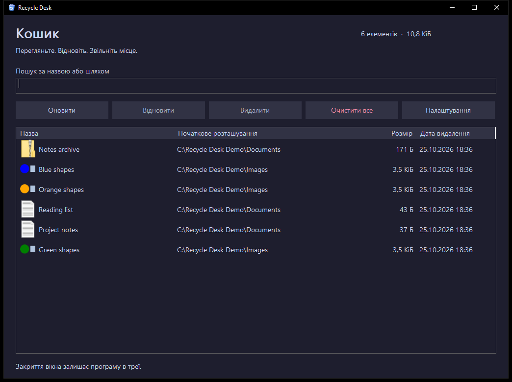
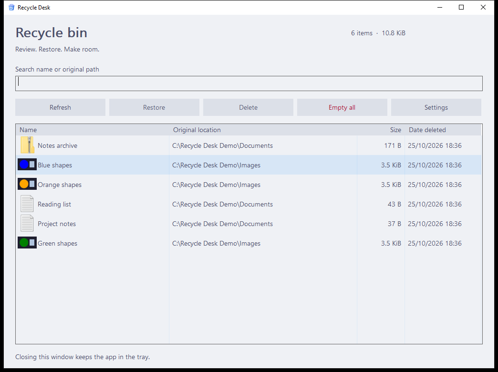
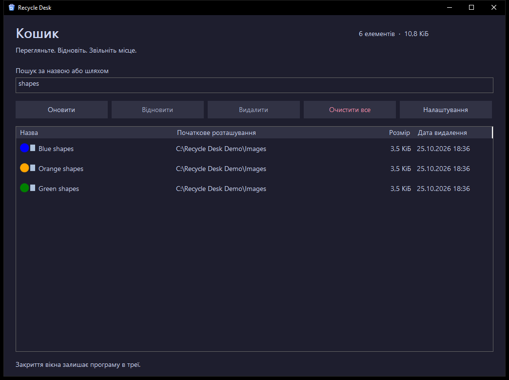

# Pullora Assets

Публічне сховище іконок і скриншотів застосунків [CpPrice11](https://github.com/CpPrice11) для [Pullora](https://github.com/CpPrice11/pullora).

Pullora доступний усім. Автор розвиває лаунчер насамперед для себе та власного використання, а його каталог складається із застосунків `CpPrice11`. Зображення в цьому репозиторії спільні для користувачів лаунчера; власні зображення в налаштуваннях матимуть пріоритет.

[Код лаунчера](https://github.com/CpPrice11/pullora) · [Завантажити Pullora](https://github.com/CpPrice11/pullora/releases/latest) · [Маніфест](manifest.json) · [Джерела](SOURCES.md)

## Що вже є

| Застосунок | Іконка | Скриншоти |
| --- | --- | --- |
| [Fandom Translator](https://github.com/CpPrice11/fandom-translator) | [PNG](media/cpprice11/fandom-translator/icon-v1.png) | Ще не додані |
| [MY SAM](https://github.com/CpPrice11/steam-achievement-manager) | [PNG](media/cpprice11/steam-achievement-manager/icon-v2.png) | Ще не додані |
| [Recycle Desk](https://github.com/CpPrice11/recycle-desk) | [PNG](media/cpprice11/recycle-desk/icon-v2.png) | [Темна тема](media/cpprice11/recycle-desk/main-dark-uk-v012.png), [світла тема](media/cpprice11/recycle-desk/main-light-en-v012.png), [пошук](media/cpprice11/recycle-desk/search-dark-uk-v012.png) |

### Recycle Desk

Версія 0.1.2 з демонстраційними файлами.

| Українська, темна тема | English, light theme |
| --- | --- |
|  |  |



Підключення сховища та галерея реалізовані локально в Pullora, але ще не входять до опублікованого `v5.22.1`. Потрібні нативна перевірка та окремий випуск лаунчера. Саме сховище й файли вже доступні без токена.

## Як додати або замінити зображення

1. Додайте PNG, JPEG або WebP до `media/cpprice11/<repo>/`. Назви мають бути в нижньому регістрі, починатися з латинської літери або цифри й містити лише латинські літери, цифри, `-`, `_`, `.`. Розмір файла: до 4 MiB, довжина його імені: до 120 символів.
2. У `manifest.json` додайте запис `cpprice11/<repo>`. Поле `icon` містить шлях до іконки або `null`; `screenshots` містить до восьми шляхів.
3. Для заміни файла використайте нове ім'я, наприклад `icon-v2.png` чи `library-v2.webp`. Лаунчер використовуватиме ім'я як версію кешованого зображення.
4. Запишіть джерело та умови використання в `SOURCES.md`. Скриншоти мають показувати справжній інтерфейс і не містити приватних даних чи секретів.
5. Запустіть перевірку з кореня репозиторію та збережіть зміни в `main`:

```powershell
python scripts/check_manifest.py
```

Приклад маніфесту для програми `app-name`:

```json
{
  "version": 1,
  "projects": {
    "cpprice11/app-name": {
      "icon": "media/cpprice11/app-name/icon-v1.png",
      "screenshots": ["media/cpprice11/app-name/library-v1.webp"]
    }
  }
}
```

Маніфест обмежений 128 KiB і 128 програмами власника `CpPrice11`. Шляхи відносні до кореня цього репозиторію. Зовнішні URL, SVG і виконувані файли не підтримуються. Імена зображень у прикладі показують формат, а не наявні файли.

## Поведінка підготовленої інтеграції

- Іконки відображаються в картках і заголовку подробиць. Пріоритет: власна обкладинка, типова іконка, аватар GitHub.
- Скриншоти завантажуються при відкритті подробиць і показуються галереєю зі збільшенням. Якщо їх немає, галерея прихована.
- Кнопка оновлення бібліотеки перевіряє маніфест відразу; кеш чинного маніфесту використовується до години.
- Файли зберігаються локально. У разі недоступності мережі лаунчер використовує раніше завантажені ресурси.
- Репозиторій `pullora-assets` прихований зі списку встановлюваних програм.

Це опис підготовленого коду, а не підтвердження нативної перевірки чи наявності цих можливостей у поточному EXE.

## Джерела та права

Походження кожного зображення й наявні ліцензії наведені в [SOURCES.md](SOURCES.md). Спільної ліцензії на всі зображення немає; права залишаються в їхніх авторів. Публічний доступ до сховища сам собою не змінює умов використання ресурсів.

## English

This public repository stores application icons and screenshots for [Pullora](https://github.com/CpPrice11/pullora). Anyone can use the launcher; its author develops it primarily for their own use, and its catalog contains CpPrice11's applications.

Three application icons and three real Recycle Desk 0.1.2 screenshots are available. The Recycle Desk icon is centered on a transparent 256×256 canvas. Its gallery shows dark and light themes and a search example with demo files. The launcher integration and gallery are local work and have not shipped in `v5.22.1`; native validation and a launcher release are still pending. The prepared integration prioritizes custom artwork, caches downloaded images, and loads screenshots when details are opened.

Add images under `media/cpprice11/<repo>/`, register them in `manifest.json`, and document their sources and rights in `SOURCES.md`. Use new filenames for replacements and run `python scripts/check_manifest.py` before publishing. See the Ukrainian instructions above for the exact format and limits.
